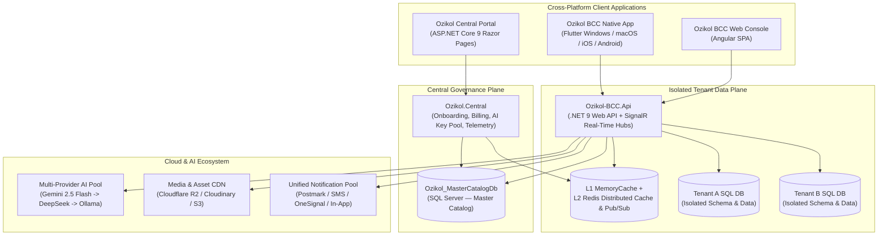

# Ozikol Business Command Center (Ozikol BCC)

**Live Platform:** [https://ozikol.cloud](https://ozikol.cloud)

**Ozikol Business Command Center (BCC)** is an enterprise, multi-tenant SaaS operations, governance, and workspace platform engineered on **.NET 9 Clean Architecture**, **Angular**, and **Flutter (Desktop & Mobile)**. It combines a sovereign Central Control Plane with physically isolated per-tenant databases, multi-tier distributed caching, authenticated column-level encryption, and an integrated multi-provider AI Studio.

---

## System Architecture



---

## Key Engineering Highlights

- **Strict Physical Multi-Tenant Isolation**:
  - **Master Control Plane** (`Ozikol.MasterDomain`, `Ozikol.MasterPersistence.EF.MasterSQL`) governs tenant provisioning, 45 modular platform capabilities across 10 feature suites, subscriptions, and global security policies.
  - **Tenant Data Plane** (`Ozikol-BCC.Domain`, `Ozikol-BCC.Persistence.EF.SQL`) provisions and resolves dedicated SQL Server databases per tenant organization dynamically per HTTP/SignalR request, guaranteeing zero cross-tenant data leakage.
- **L1 + L2 Distributed Caching with Cross-Node Invalidation**:
  - Combines ultra-low-latency in-process `IMemoryCache` (L1) with `StackExchange.Redis` distributed cache (L2) and Redis Pub/Sub (`ozikol:channel:tenant-catalog-invalidate`) for instant cache eviction across scaled API nodes, with automatic graceful fallback when Redis is absent.
- **Authenticated Cryptography at Rest (`AES-256-GCM`)**:
  - Sensitive database columns (tenant connection strings, payment gateway secrets, SMTP credentials, and AI API keys) are transparently encrypted and authenticated at rest via EF Core value converters (`OzikolDataCipher`) using NIST-standard 96-bit nonces and 128-bit authentication tags.
- **Resilient AI Studio Key Pool & Provider Failover**:
  - Dynamically manages a round-robin pool of AI provider keys with quota tracking and automatic `429 Too Many Requests` cooldown rotation across **Google Gemini 2.5 Flash** (primary) → **DeepSeek** (secondary failover) → **Ollama** (local fallback).
- **Unified Multi-Channel Notification Architecture**:
  - Centralizes In-App real-time SignalR alerts, transactional emails (with real-time anti-spam deliverability scanning), SMS, and push notifications through an auditable, idempotent message queue pool.
- **Standardized Error Isolation (`ERR-1000` – `ERR-9999`)**:
  - Enforces strict separation between localized client-safe error codes (`ApiResponse<T>`) and internal exception telemetry (`GlobalExceptionHandlingMiddleware`, Sentry PII scrubbing, and Central correlation trace logs).
- **Full Cross-Platform Parity**:
  - Delivered cohesively across **ASP.NET Core 9**, **Angular**, and **Flutter** (Windows, macOS, Linux, Android, and iOS), backed by automated GitHub Actions CI/CD workflows (`.github/workflows/`).

---

## Repository Structure

```text
Ozikol-BCC/
├── src/
│   ├── Ozikol.Central/                        # Central Governance Portal & Public Landing Site (.NET 9 Razor Pages)
│   ├── Ozikol.MasterDomain/                   # Master Catalog entities, security ciphers & contracts
│   ├── Ozikol.MasterPersistence.EF.MasterSQL/ # Master EF Core DbContext, migrations & seeders
│   ├── Ozikol.MasterPersistence.EF.DbMigrator/# Automated Master DB migration & seeding runner
│   ├── Ozikol-BCC.Api/                        # Multi-Tenant REST API & SignalR Hubs (.NET 9)
│   ├── Ozikol-BCC.Api.Tests/                  # Automated backend unit & integration test suite
│   ├── Ozikol-BCC.Application/                # CQRS / MediatR handlers, DTOs & business services
│   ├── Ozikol-BCC.Domain/                     # Tenant domain models & core interfaces
│   ├── Ozikol-BCC.Infrastructure/             # Multi-tenancy resolution, Redis L1/L2 cache & security
│   ├── Ozikol-BCC.Persistence.EF.SQL/         # Tenant EF Core DbContext & migrations
│   ├── Ozikol-BCC.Client/                     # Tenant Admin & Workspace SPA (Angular)
│   ├── Ozikol-BCC.AiServices/                 # Multi-provider AI Studio integration layer
│   ├── Ozikol-BCC.PaymentServices*/           # Payment gateway abstractions & Paystack/Stripe adapters
│   ├── Ozikol-BCC.EmailServices*/             # Postmark & ZeptoMail transactional email providers
│   ├── Ozikol-BCC.StorageServices.AwsS3/      # Cloud object storage & R2/S3/Cloudinary services
│   └── Ozikol-BCC.Telemetry.Sentry/           # Observability & PII-scrubbed crash telemetry
├── FutterMobDeskApp/                          # Native Desktop & Mobile client (Flutter — Win/macOS/Linux/iOS/Android)
└── .github/workflows/                         # Automated CI/CD pipelines (API, Central, Angular Client)
```

---

## Local Development Setup

### Prerequisites
- **.NET 9.0 SDK**
- **SQL Server** (Express, Developer, or Container)
- **Node.js 20+** & **Angular CLI** (for `Ozikol-BCC.Client`)
- **Flutter SDK 3.x** (optional, for `FutterMobDeskApp`)
- **Redis** (optional — automatically falls back to in-memory cache in local dev)

### 1. Configure Environment Variables
No secrets or connection strings are hardcoded in source control. Copy the provided `.env.example` templates in each runnable project and populate your local values:

```bash
cp src/Ozikol.Central/.env.example src/Ozikol.Central/.env
cp src/Ozikol-BCC.Api/.env.example src/Ozikol-BCC.Api/.env
cp src/Ozikol-BCC.Client/.env.example src/Ozikol-BCC.Client/.env
```

### 2. Initialize & Seed the Master Catalog Database
```bash
dotnet run --project src/Ozikol.MasterPersistence.EF.DbMigrator/Ozikol.MasterPersistence.EF.DbMigrator.csproj
```

### 3. Build & Run
```bash
# Build the entire .NET 9 solution
dotnet build Ozikol-BCC.sln -c Release

# Run Ozikol Central Portal
dotnet run --project src/Ozikol.Central/Ozikol.Central.csproj

# Run Multi-Tenant Web API
dotnet run --project src/Ozikol-BCC.Api/Ozikol-BCC.Api.csproj

# Run Angular Workspace Client
cd src/Ozikol-BCC.Client && npm install && npm start
```

---

## Engineering & Contribution Standards

1. **Branching Discipline**: Never commit directly to `master`. Use dedicated task branches (`feat/<name>`, `fix/<name>`, `refactor/<name>`, `chore/<name>`) and Conventional Commits (`feat(scope): summary`).
2. **Master vs. Tenant Layer Isolation**: Never cross-reference entities or `DbContext` types between `MasterDomain` and tenant `Domain` layers.
3. **Zero Hardcoded Secrets**: Resolve all credentials strictly via `.env` or environment variables.
4. **Documentation**: All public classes, interfaces, methods, and properties include complete XML documentation (`/// <summary>`).
