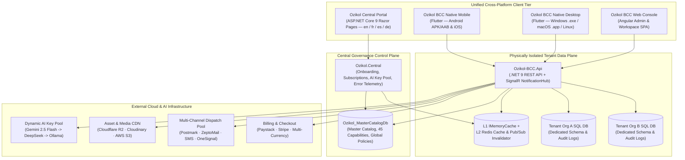

# Ozikol Business Command Center (Ozikol BCC)

**Live Platform:** [https://ozikol.cloud](https://ozikol.cloud)  
**Stack:** `.NET 9 (ASP.NET Core, EF Core, SignalR)` · `Angular` · `Flutter (Windows, macOS, Linux, iOS, Android)` · `SQL Server (Database-per-Tenant)` · `Redis L1/L2` · `Multi-Provider AI Studio`

**Ozikol Business Command Center (Ozikol BCC)** is a full-stack, enterprise multi-tenant SaaS operations, governance, and workspace platform. Engineered on **Clean Architecture** and **Domain-Driven Design (DDD)** principles, it pairs a sovereign **Central Governance Control Plane** with **physically isolated per-tenant SQL Server databases**, real-time cross-platform SignalR synchronization, authenticated `AES-256-GCM` column encryption at rest, a resilient multi-provider AI Studio, and **1-to-1 feature parity across Web, Native Desktop, and Native Mobile**.

---

## Table of Contents

1. [System Architecture](#1-system-architecture)
2. [Complete Monorepo Project Catalog (All 22 Projects)](#2-complete-monorepo-project-catalog-all-22-projects)
3. [Native Desktop & Mobile Applications (Flutter)](#3-native-desktop--mobile-applications-flutter)
4. [Angular Web Console & Visual Template Studio](#4-angular-web-console--visual-template-studio)
5. [Full Platform Capability Catalog (All 45 Features Across 10 Suites)](#5-full-platform-capability-catalog-all-45-features-across-10-suites)
6. [Security, Cryptography, Caching & Error Isolation](#6-security-cryptography-caching--error-isolation)
7. [Automated CI/CD & Local Development Setup](#7-automated-cicd--local-development-setup)
8. [Engineering & Contribution Standards](#8-engineering--contribution-standards)

---

## 1. System Architecture

### Control Plane vs. Isolated Tenant Data Plane



---

## 2. Complete Monorepo Project Catalog (All 22 Projects)

The repository is structured into strictly isolated Clean Architecture boundaries ensuring zero cross-contamination between the **Master Control Plane** and **Tenant Data Plane**:

### A. Central Governance & Master Persistence Layer (`src/Ozikol.*`)

| Project | Target | Architectural Responsibility |
| :--- | :--- | :--- |
| **`Ozikol.Central`** | `.NET 9 Web` | Public multi-language platform website (`en`, `fr`, `es`, `de`), automated self-service workspace onboarding, **Centralwks** operator console, **Affiliate Partner** portal, **Template Creator** studio, AI Key Pool health manager, and Master/Tenant migration dashboard. |
| **`Ozikol.MasterDomain`** | `.NET 9 Lib` | Sovereign Master Catalog entities (`MasterTenantCatalog`, `MasterFeatureCatalog`, `MasterFeatureSuite`, `MasterAiApiKey`, `MasterPlatformSetting`), role definitions, and `OzikolDataCipher` (`AES-256-GCM`). |
| **`Ozikol.MasterPersistence.EF.MasterSQL`** | `.NET 9 Lib` | `MasterCatalogDbContext`, encrypted EF Core `ValueConverter` mappings, immutable forward-only Master SQL migrations, and `MasterCatalogDataSeeder` (seeds all 10 suites, 45 capabilities, legal compliance policies, and RBAC roles). |
| **`Ozikol.MasterPersistence.EF.DbMigrator`** | `.NET 9 Console` | Headless automated database migration and seeding runner (`MasterDbMigratorHostedService`) with retry resilience for CI/CD and cloud database provisioning. |

### B. Multi-Tenant Core, Application & Data Plane (`src/Ozikol-BCC.*`)

| Project | Target | Architectural Responsibility |
| :--- | :--- | :--- |
| **`Ozikol-BCC.Api`** | `.NET 9 Web API` | Multi-tenant REST API controllers, real-time SignalR `NotificationHub`, JWT + 2FA TOTP authentication, sliding/fixed-window rate limiting, CORS governance, and standardized `ApiResponse<T>` error isolation. |
| **`Ozikol-BCC.Api.Tests`** | `.NET 9 Test` | Automated backend unit and integration test suite validating multi-tenant isolation, authentication flows, and domain invariants. |
| **`Ozikol-BCC.Application`** | `.NET 9 Lib` | CQRS / MediatR command & query handlers, DTO contracts, domain validators, template image optimization, and business orchestration services. |
| **`Ozikol-BCC.Domain`** | `.NET 9 Lib` | Tenant-scoped domain models (identity, roles, audit trails, notifications, email/SMS queues, CMS page sections, billing records, workstation policies, and modular capability entities). |
| **`Ozikol-BCC.Infrastructure`** | `.NET 9 Lib` | Per-request dynamic tenant resolution (`AddTenantSupport`), L1 (`IMemoryCache`) + L2 (`StackExchange.Redis`) distributed caching, Redis Pub/Sub cross-server cache eviction (`RedisTenantCacheInvalidator`), and background workers. |
| **`Ozikol-BCC.Persistence.EF.SQL`** | `.NET 9 Lib` | Tenant-isolated `DbContext`, automated EF Core change-tracking audit trail with 30-day diff retention, and per-tenant schema migrations. |
| **`Ozikol-BCC.Persistence.EF.DbMigrator`** | `.NET 9 Console` | Automated schema migration runner capable of upgrading isolated tenant databases across the organization catalog. |

### C. Specialized Cloud, AI, Messaging, Payment & Telemetry Libraries

| Project | Target | Architectural Responsibility |
| :--- | :--- | :--- |
| **`Ozikol-BCC.AiServices`** | `.NET 9 Lib` | Multi-provider AI Studio integration supporting **Google Gemini 2.5 Flash** (primary), **DeepSeek Chat/Coder** (secondary failover), and **Ollama** (local fallback) with round-robin quota balancing and `429` cooldown rotation. |
| **`Ozikol-BCC.BotProtectionServices`** | `.NET 9 Lib` | Server-side verification for Google reCAPTCHA v2/v3 and automated abuse prevention on public authentication and submission endpoints. |
| **`Ozikol-BCC.CloudinaryServices`** | `.NET 9 Lib` | Dual-mode media asset management supporting both platform-level storage and autonomous per-tenant Cloudinary credentials. |
| **`Ozikol-BCC.StorageServices.AwsS3`** | `.NET 9 Lib` | S3-compatible object storage adapter powering **Cloudflare R2** global CDN asset delivery and AWS S3 buckets with pre-flight security scanning. |
| **`Ozikol-BCC.EmailServices.Postmark`** | `.NET 9 Lib` | Enterprise Postmark transactional & broadcast email suite (single, batch, templated, attachments) paired with anti-spam keyword, ALL-CAPS, link-shortener, and image-to-text ratio validation. |
| **`Ozikol-BCC.EmailServices.ZeptoMail`** | `.NET 9 Lib` | Secondary transactional email delivery provider for high-availability mail routing. |
| **`Ozikol-BCC.PaymentServices`** | `.NET 9 Lib` | Unified multi-currency checkout, invoice verification, voucher calculation, and recurring capability subscription contracts. |
| **`Ozikol-BCC.PaymentServices.Paystack`** | `.NET 9 Lib` | Production Paystack payment initialization, webhook HMAC verification, and automated invoice reconciliation. |
| **`Ozikol-BCC.Telemetry.Sentry`** | `.NET 9 Lib` | Cloud crash monitoring and performance tracing with strict PII header, cookie, and credential scrubbing prior to transmission. |

### D. Web & Native Client Applications

| Project | Directory | Target Platforms |
| :--- | :--- | :--- |
| **`Ozikol-BCC.Client`** | `src/Ozikol-BCC.Client` | **Web Browser SPA** — Angular Enterprise Admin Console, Member Workspace, Visual Website/Template Studio, and Dockable Ozi AI Assistant. |
| **`FutterMobDeskApp`** | `FutterMobDeskApp/` | **5 Native Platforms from 1 Codebase** — **Windows Desktop** (`.exe`), **macOS Desktop** (`.app`), **Linux Desktop**, **Android** (`.apk` / App Bundle), and **iOS**. |

---

## 3. Native Desktop & Mobile Applications (Flutter)

Located in [`FutterMobDeskApp/`](FutterMobDeskApp/), the native client delivers **1-to-1 operational parity** with the web platform across desktop workstations and mobile devices:

### Supported Native Targets
- **Windows Desktop (`windows/`)**: Native Win32/C++ runner (`main.cpp`, `Runner.rc`), custom title-bar window controls (`window_manager`), reconfirmed exit protection, and supervised kiosk/workstation enforcement.
- **macOS Desktop (`macos/`)**: Native Cocoa/Swift `AppDelegate` bundle with full menu bar and window lifecycle integration.
- **Linux Desktop (`linux/`)**: Native GTK desktop build support.
- **Android Mobile (`android/`)**: Production Gradle configuration, deep-link intent filters, biometric/secure keystore integration, and push notification handlers.
- **iOS Mobile (`ios/`)**: Native Swift `AppDelegate` & `Info.plist` privacy compliance, Keychain secure storage, and responsive adaptive layouts.

### Key Native Engineering Capabilities
- **Supervised Desktop Workstation Mode (`lib/features/workstations/`)**:
  - Dedicated desktop-only capability allowing organizations to provision managed physical terminals, enforce active session time/policy controls, lock idle screens with quick-switch/logout controls, and monitor workstation compliance in real time.
- **Real-Time Duplex Synchronization (`signalr_netcore`)**:
  - Persistent authenticated WebSocket connection to `NotificationHub` delivering instant 6-tier severity notifications (`info`, `success`, `warning`, `danger`, `urgent`, `critical`), live billing/subscription state updates, and security alerts (new device login, password/2FA changes).
- **Hardware-Backed Credential Security (`flutter_secure_storage` + `dio`)**:
  - Stores JWT/refresh tokens inside Windows Credential Locker, macOS/iOS Keychain, and Android EncryptedSharedPreferences/Keystore.
  - Automated PII/API-key redaction in local logs and crash reports (`crash_reporter_service.dart`, `app_logger.dart`).
- **Native Document & Report Printing (`pdf` + `printing`)**:
  - Generates vector PDFs, receipts, audit logs, and digital ID cards directly on-device with native OS print-spooler integration.
- **Responsive Adaptive Shell & Localization**:
  - Dynamically adapts between multi-column desktop navigation drawers and touch-first mobile bottom sheets/layouts, with full 4-language parity (`en`, `fr`, `es`, `de`), interactive screen tour guides, and contextual `(i)` info popovers/bottom sheets.

---

## 4. Angular Web Console & Visual Template Studio

Located in [`src/Ozikol-BCC.Client/`](src/Ozikol-BCC.Client/), the Angular SPA powers both tenant administration and day-to-day member collaboration:

- **Master HTML Document Assembler (`HtmlAssemblerService`)**:
  - Synthesizes isolated iframe section previews and complete multi-zone production web pages (Navbar + Hero + Breadcrumbs + Body Sections + Blog + Footer + Head/Body/Footer Custom Code Injections) backed by pre-flight security scanning.
- **Modular Category Hydration Engine (`services/hydrators/`)**:
  - Dedicated token-replacement hydrators (`navigation-hydrator`, `hero-hydrator`, `breadcrumb-hydrator`, `body-sections-hydrator`, `footer-hydrator`, `blog-feed-hydrator`, `blog-detail-hydrator`) prioritizing live tenant database configuration over fallback sample JSON.
- **Responsive Split-Screen Ozi AI Studio (`app-ai-assistant`)**:
  - Non-overlapping flexbox docking (`docked-right` 70%/30% split, `docked-bottom` vertical split, or explicit `floating` window) so AI-assisted authoring never obscures workspace forms, tables, or code editors.
- **Real-Time Email Deliverability & Anti-Spam Scanner**:
  - Client-side as-you-type analysis flagging ALL-CAPS subjects, spam trigger phrases, unencrypted/shortened links, and poor text-to-image ratios before broadcast queuing.

---

## 5. Full Platform Capability Catalog (All 45 Features Across 10 Suites)

Ozikol BCC organizes its **45 modular capabilities** across **10 domain suites** (plus **Supervised Desktop Workstations**), governed centrally in `MasterFeatureCatalog` and dynamically activated per tenant workspace:

### Suite 1: People, Community & Collaboration (4 Features)
| # | Capability | Summary |
| :-: | :--- | :--- |
| 1 | **Community Messenger & Team Chat** | Real-time direct and channel messaging for internal teams and organizational members. |
| 2 | **Committees & Sub-Groups** | Structured working groups, boards, departments, and delegated sub-community workspaces. |
| 3 | **Alumni Network & Directory** | Searchable member/alumni directories, cohort networking, and profile verification. |
| 4 | **Anonymous Whistleblowing & Feedback** | Encrypted, zero-retaliation ethics reporting and anonymous organizational feedback boxes. |

### Suite 2: Workforce, Rota & Scheduling (5 Features)
| # | Capability | Summary |
| :-: | :--- | :--- |
| 5 | **Staff & Volunteer Rota Scheduling** | Multi-shift duty rosters, role capacity planning, and automated conflict detection. |
| 6 | **Shift Swaps & Leave Management** | Self-service shift trade requests, PTO/leave balances, and multi-stage supervisor approvals. |
| 7 | **Biometric & QR Attendance Tracking** | Time-clock check-in/out with dynamic QR codes, geofencing, and attendance analytics. |
| 8 | **Appointment & Facility Booking** | Room, resource, and consultation slot reservations with automated reminders. |
| 9 | **Calendar & Automated Follow-Up Routine** | Shared organizational calendars paired with rule-driven member follow-up workflows. |

### Suite 3: Reports, Forms & Analytics (4 Features)
| # | Capability | Summary |
| :-: | :--- | :--- |
| 10 | **Interval & Periodic Reporting** | Scheduled daily, weekly, monthly, and quarterly operational KPI submissions and rollups. |
| 11 | **Custom Dynamic Form Builder** | Drag-and-drop conditional schema forms, file uploads, and structured workflow routing. |
| 12 | **Survey & Opinion Poll Analytics** | Real-time organizational surveys, sentiment charts, and cross-tabulated response exports. |
| 13 | **Reference Form & Referee Verification** | Automated external referee requests, digital verification tokens, and authenticity tracking. |

### Suite 4: Events & Training Management (3 Features)
| # | Capability | Summary |
| :-: | :--- | :--- |
| 14 | **Event Ticketing & Registration** | Multi-tier free/paid event registration, promo vouchers, and capacity waitlists. |
| 15 | **Speaker & Session Management** | Multi-track conference agendas, speaker bios, abstract submissions, and room assignments. |
| 16 | **Attendee Management & QR Check-in** | Fast mobile/desktop badge scanning, live door counts, and post-event attendance logs. |

### Suite 5: Finance & Commercial Revenue (5 Features)
| # | Capability | Summary |
| :-: | :--- | :--- |
| 17 | **Invoicing, Dues & Pledges** | Recurring membership dues, custom invoices, pledge installment tracking, and receipts. |
| 18 | **Store & E-Commerce Catalog** | Digital and physical product storefront, inventory variants, and integrated gateway checkout. |
| 19 | **Proposal & Grant Pipeline** | End-to-end funding proposal lifecycle, milestone deadlines, and donor/sponsor tracking. |
| 20 | **Grant & Project Ledger** | Restricted-fund accounting, budget-vs-actual burn tracking, and auditable expense vouchers. |
| 21 | **Embedded Banking, Wallets & Transfers** | Organizational sub-wallets, automated split settlements, and reconciliation ledgers. |

### Suite 6: Operations & Workflows (5 Features)
| # | Capability | Summary |
| :-: | :--- | :--- |
| 22 | **Recruitment & Applicant Tracking** | Job requisitions, career portal applications, interview scorecards, and offer pipelines. |
| 23 | **Elections & Secure E-Voting** | Tamper-evident digital ballots, voter eligibility rolls, and instant cryptographic tallies. |
| 24 | **Equipment & Logistics Management** | Vehicle, machinery, maintenance schedule, fuel/usage logs, and operator assignment tracking. |
| 25 | **Fixed Asset & Tag Registry** | Barcode/QR asset tagging, custodian chain-of-custody, and depreciation lifecycle tracking. |
| 26 | **Project & Task Tracking Board** | Kanban boards, sprint milestones, assignees, SLA due dates, and deliverable checklists. |

### Suite 7: Communication, AI & Support (7 Features)
| # | Capability | Summary |
| :-: | :--- | :--- |
| 27 | **AI Smart Assist & Workflows** | Contextual AI copilot for drafting communications, summarizing reports, and automating tasks. |
| 28 | **Mass Multi-Channel SMS & Email** | Segmented bulk broadcasts via Postmark/SMS queues with real-time spam-score protection. |
| 29 | **Helpdesk & Ticketing Support** | Multi-category support queues, SLA timers, internal agent notes, and auto-close rules. |
| 30 | **Live Chat & Widget Messenger** | Embeddable website visitor chat routed directly into the unified workspace inbox. |
| 31 | **Social Media Publisher & Queue** | Multi-channel social content calendar, asset library, and scheduled post publishing. |
| 32 | **Bio Link Hub & Public Microsite** | Branded quick-action landing hub consolidating announcements, forms, and payment links. |
| 33 | **GoCall AI Emergency & Voice Dispatch** | High-priority automated voice/alert escalation for urgent operational incidents. |

### Suite 8: Compliance, Learning & Certification (5 Features)
| # | Capability | Summary |
| :-: | :--- | :--- |
| 34 | **Document Vault & Revision Control** | Versioned policy repositories, role-restricted folders, and mandatory read acknowledgments. |
| 35 | **Learning Management & Course LMS** | Self-paced training modules, video lessons, quizzes, and cohort completion tracking. |
| 36 | **Certificate Issuance & Verification** | Branded verifiable PDF certificates with public QR authenticity lookup endpoints. |
| 37 | **Visitor & Gate Pass Management** | Pre-authorized guest access codes, host arrival alerts, and security desk check-in logs. |
| 38 | **Official KYC & Identity Verification** | Government ID document capture, liveness/profile review, and compliance audit trails. |

### Suite 9: Demographics & Civic Census (4 Features)
| # | Capability | Summary |
| :-: | :--- | :--- |
| 39 | **Community & Household Census** | Structured household registries, dependent mapping, and socio-economic demographic profiling. |
| 40 | **Offline Field Surveyor & GPS** | Offline-capable mobile data capture with geolocation coordinates and background sync when online. |
| 41 | **Resident PVC & Digital ID Cards** | Print-ready PVC smart card layouts and mobile wallet digital member identification cards. |
| 42 | **Demographic & Spatial Analytics** | Regional distribution heatmaps, age/occupation pyramids, and population trend dashboards. |

### Suite 10: Life Events & Publications (3 Features)
| # | Capability | Summary |
| :-: | :--- | :--- |
| 43 | **Digital Memorials & Funeral Tributes** | Dedicated tribute microsites, condolence books, event programs, and media galleries. |
| 44 | **Weddings & Celebration Portals** | RSVP management, guest seating, gift registries, and celebration photo sharing. |
| 45 | **Digital Brochures & Magazine Publishing** | Interactive flipbooks, newsletters, annual reports, and downloadable editorial publications. |

> **Plus Dedicated Native Desktop Capability — `Workspace (Desktop Only)`**: Managed physical workstation registration, active terminal lock/unlock controls, and desktop process governance via `FutterMobDeskApp`.

---

## 6. Security, Cryptography, Caching & Error Isolation

- **Zero Hardcoded Secrets**: All database connection strings, JWT signing keys, Master encryption keys, and third-party API tokens are resolved strictly from `.env` or OS environment variables (`.env` files are git-ignored across history; `.env.example` templates document every variable).
- **Authenticated `AES-256-GCM` Column Encryption (`OzikolDataCipher`)**: Protects tenant SQL connection strings, payment gateway secret keys, SMTP passwords, and AI provider keys at rest with versioned `enc:v1:` ciphertext prefixes for zero-downtime key rotation.
- **Two-Tier L1 + L2 Caching**: Sub-millisecond local `IMemoryCache` synchronized across scaled server instances via Redis `IDistributedCache` and Redis Pub/Sub (`ozikol:channel:tenant-catalog-invalidate`).
- **Strict Client vs. Central Error Isolation (`ERR-1000` – `ERR-9999`)**:
  - **Tenant / Public Clients** receive only a standardized `errorCode` (e.g., `ERR-3001`), localized safe `message`, and `traceId` — never stack traces, SQL errors, or raw gateway exceptions.
  - **Central Operators** inspect full correlated diagnostics (`RealError`, stack trace, endpoint, tenant, IP) exclusively inside `/centralwks/error-logs`.

---

## 7. Automated CI/CD & Local Development Setup

### Automated GitHub Actions Workflows (`.github/workflows/`)
- **`deploy-central.yml`**: Path-filtered `.NET 9` Release publish and zero-downtime SSH/systemd deployment for `Ozikol.Central` (preserving server `.env`).
- **`deploy-api.yml`**: Automated build, publish, and service rollout for `Ozikol-BCC.Api`.
- **`deploy-client.yml`**: Production Angular AOT bundle build and static asset synchronization for `Ozikol-BCC.Client`.

### Local Quick-Start

#### 1. Configure Environment Files
Copy the clean `.env.example` templates and supply your local development credentials:
```bash
cp src/Ozikol.Central/.env.example src/Ozikol.Central/.env
cp src/Ozikol-BCC.Api/.env.example src/Ozikol-BCC.Api/.env
cp src/Ozikol-BCC.Client/.env.example src/Ozikol-BCC.Client/.env
```

#### 2. Migrate & Seed the Master Catalog Database
```bash
dotnet run --project src/Ozikol.MasterPersistence.EF.DbMigrator/Ozikol.MasterPersistence.EF.DbMigrator.csproj
```

#### 3. Build & Launch Backend / Web
```bash
# Build all 20 .NET 9 projects in Release mode
dotnet build Ozikol-BCC.sln -c Release

# Launch Ozikol Central Portal
dotnet run --project src/Ozikol.Central/Ozikol.Central.csproj

# Launch Multi-Tenant Web API
dotnet run --project src/Ozikol-BCC.Api/Ozikol-BCC.Api.csproj

> **IMPORTANT**: Direct pushes and local merges to `master` are strictly disabled. All features, fixes, and updates must be pushed on dedicated task branches and merged via **GitHub Pull Requests**.

### 1. Branch Naming Conventions
Always create a descriptive branch off `master` before writing code or committing:
* **Features**: `feat/<feature-name>` or `feature/<feature-name>`
  * Example: `feat/templates-page-section`
* **Bug Fixes**: `fix/<bug-name>`
  * Example: `fix/online-tenant-cors-api-url`
* **Refactoring & Maintenance**: `refactor/<name>` or `chore/<name>`
  * Example: `chore/cleanup-python-scripts`
* **Documentation**: `docs/<topic>`
  * Example: `docs/git-branching-guidelines`

### 2. Pull Request & Deployment Workflow
1. Work and commit strictly on your dedicated branch.
2. Push your branch to GitHub: `git push -u origin <branch-name>`.
3. Open a GitHub Pull Request into `master`.
4. Review and merge the Pull Request on GitHub. GitHub Actions CI/CD workflows will automatically trigger to build and deploy the affected components (API, Client, Central) to the VPS.

### 3. Commit Message Standards
Follow the Conventional Commits specification:
* **Format**: `<type>(<scope>): <concise summary>` followed by a bulleted body explaining what changed and why.
* **Types**: `feat:`, `fix:`, `refactor:`, `style:`, `docs:`, `chore:`.
* **Example**:
  ```
  feat(content): implement page section list templates

# Build Production Native Releases
flutter build windows --release
flutter build apk --release
flutter build ios --release
```

---

## 8. Engineering & Contribution Standards

1. **Protected Branch Workflow**: Never commit directly to `master`. All changes use dedicated branches (`feat/<name>`, `fix/<name>`, `refactor/<name>`, `chore/<name>`) merged via Pull Request.
2. **Conventional Commits**: Every commit follows `<type>(<scope>): <concise summary>` with a zero-error pre-commit build requirement.
3. **Strict Layer Isolation**: Never cross-reference models, `DbContext` types, or migrations between `Ozikol.MasterDomain` and `Ozikol-BCC.Domain`.
4. **Full Cross-Platform Parity**: Every domain capability is delivered cohesively across Backend API, Angular Web, Flutter Desktop, and Flutter Mobile with complete XML documentation (`/// <summary>`).
