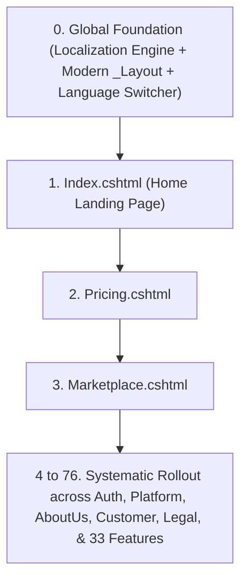

# Master Roadmap: Section-by-Section Redesign & Multi-Language Localization

This plan establishes a numbered roadmap for redesigning every single section across all **76 pages** of `Ozikol.Central`, while integrating native ASP.NET Core multi-language localization (`en`, `fr`, `es`, `de`).

---

## 1. System Architecture: Redesign + Localization Workflow

For every page on this list, the execution standard is:
1. **Section Breakdown & Redesign**:
   * Audit all sections (Hero, FastNav, Feature Cards, Grid, Testimonials, CTAs).
   * Elevate the design: rich modern typography, subtle micro-interactions, smooth hover states, responsive layouts, glassmorphism accents, and zero generic placeholders.
2. **Multi-Language Extraction**:
   * Replace all hardcoded strings with strongly-typed `SharedResource` or page-level resource keys.
   * Provide initial localized dictionaries for **English (Default)**, **French (Français)**, **Spanish (Español)**, and **German (Deutsch)**.
3. **Quality & Validation**:
   * Build verification (`0 Errors`).
   * Clean Git commit with standard conventional format.

---

## 2. Master Execution Order

---

### Phase 0: Global Foundation & Master Layout (Immediate Prerequisite)
* [ ] **0. Foundation**:
  * Configure `AddLocalization()` & `UseRequestLocalization()` in [Program.cs](file:///c:/Users/JURAY/source/Ozikol-BCC/src/Ozikol.Central/Program.cs).
  * Create `SharedResource.cs` and base `.resx` files.
  * Implement [SetLanguage.cshtml.cs](file:///c:/Users/JURAY/source/Ozikol-BCC/src/Ozikol.Central/Pages/SetLanguage.cshtml.cs) culture switch handler.
  * Redesign & localize [Pages/Shared/_Layout.cshtml](file:///c:/Users/JURAY/source/Ozikol-BCC/src/Ozikol.Central/Pages/Shared/_Layout.cshtml) (Header, Mega Menus, Flag/Language Dropdown, Search Modal, and Footer).

---

### Phase 1: Core Portal & Commercial Experience
* [ ] **1. [Pages/Index.cshtml](file:///c:/Users/JURAY/source/Ozikol-BCC/src/Ozikol.Central/Pages/Index.cshtml)** — Main Home Landing (Hero, FastNav, Interactive Tabs, Metrics, Enterprise Trust)
* [ ] **2. [Pages/Pricing.cshtml](file:///c:/Users/JURAY/source/Ozikol-BCC/src/Ozikol.Central/Pages/Pricing.cshtml)** — Pricing Tiers, Plan Matrix & Calculator
* [ ] **3. [Pages/Marketplace.cshtml](file:///c:/Users/JURAY/source/Ozikol-BCC/src/Ozikol.Central/Pages/Marketplace.cshtml)** — App Store & Extensions Grid
* [ ] **4. [Pages/News.cshtml](file:///c:/Users/JURAY/source/Ozikol-BCC/src/Ozikol.Central/Pages/News.cshtml)** — Press Releases, Insights & Articles
* [ ] **5. [Pages/Careers.cshtml](file:///c:/Users/JURAY/source/Ozikol-BCC/src/Ozikol.Central/Pages/Careers.cshtml)** — Life at Ozikol & Job Board
* [ ] **6. [Pages/DeveloperApi.cshtml](file:///c:/Users/JURAY/source/Ozikol-BCC/src/Ozikol.Central/Pages/DeveloperApi.cshtml)** — Developer Documentation & API Keys

---

### Phase 2: Authentication & Onboarding
* [ ] **7. [Pages/Auth/Login.cshtml](file:///c:/Users/JURAY/source/Ozikol-BCC/src/Ozikol.Central/Pages/Auth/Login.cshtml)** — Central Portal Sign-in & MFA Verification
* [ ] **8. [Pages/Auth/GetStarted.cshtml](file:///c:/Users/JURAY/source/Ozikol-BCC/src/Ozikol.Central/Pages/Auth/GetStarted.cshtml)** — Enterprise Multi-step Tenant Registration Wizard

---

### Phase 3: Platform Architecture
* [ ] **9. [Pages/Platform/MisSystem.cshtml](file:///c:/Users/JURAY/source/Ozikol-BCC/src/Ozikol.Central/Pages/Platform/MisSystem.cshtml)** — Management Information System
* [ ] **10. [Pages/Platform/Website.cshtml](file:///c:/Users/JURAY/source/Ozikol-BCC/src/Ozikol.Central/Pages/Platform/Website.cshtml)** — Tenant CMS & Web Builder
* [ ] **11. [Pages/Platform/MobileApp.cshtml](file:///c:/Users/JURAY/source/Ozikol-BCC/src/Ozikol.Central/Pages/Platform/MobileApp.cshtml)** — Cross-platform Mobile Suite
* [ ] **12. [Pages/Platform/AndroidApp.cshtml](file:///c:/Users/JURAY/source/Ozikol-BCC/src/Ozikol.Central/Pages/Platform/AndroidApp.cshtml)** — Google Play / Android Edition
* [ ] **13. [Pages/Platform/IosApp.cshtml](file:///c:/Users/JURAY/source/Ozikol-BCC/src/Ozikol.Central/Pages/Platform/IosApp.cshtml)** — Apple iOS App Store Edition
* [ ] **14. [Pages/Platform/DesktopApp.cshtml](file:///c:/Users/JURAY/source/Ozikol-BCC/src/Ozikol.Central/Pages/Platform/DesktopApp.cshtml)** — Windows & macOS Desktop App

---

### Phase 4: Corporate & Trust Hub
* [ ] **15. [Pages/AboutUs/AboutUs.cshtml](file:///c:/Users/JURAY/source/Ozikol-BCC/src/Ozikol.Central/Pages/AboutUs/AboutUs.cshtml)** — Mission, Origin Story & Team
* [ ] **16. [Pages/AboutUs/Leadership.cshtml](file:///c:/Users/JURAY/source/Ozikol-BCC/src/Ozikol.Central/Pages/AboutUs/Leadership.cshtml)** — Executive Team & Board
* [ ] **17. [Pages/AboutUs/Culture.cshtml](file:///c:/Users/JURAY/source/Ozikol-BCC/src/Ozikol.Central/Pages/AboutUs/Culture.cshtml)** — Engineering & Diversity Culture
* [ ] **18. [Pages/AboutUs/Offices.cshtml](file:///c:/Users/JURAY/source/Ozikol-BCC/src/Ozikol.Central/Pages/AboutUs/Offices.cshtml)** — Global Office Directory & Map
* [ ] **19. [Pages/AboutUs/Partners.cshtml](file:///c:/Users/JURAY/source/Ozikol-BCC/src/Ozikol.Central/Pages/AboutUs/Partners.cshtml)** — Alliance & Reseller Ecosystem
* [ ] **20. [Pages/AboutUs/Security.cshtml](file:///c:/Users/JURAY/source/Ozikol-BCC/src/Ozikol.Central/Pages/AboutUs/Security.cshtml)** — Encryption, WAF & Zero Trust
* [ ] **21. [Pages/AboutUs/AiSecurity.cshtml](file:///c:/Users/JURAY/source/Ozikol-BCC/src/Ozikol.Central/Pages/AboutUs/AiSecurity.cshtml)** — Responsible AI & Zero Data Retention
* [ ] **22. [Pages/AboutUs/Reliability.cshtml](file:///c:/Users/JURAY/source/Ozikol-BCC/src/Ozikol.Central/Pages/AboutUs/Reliability.cshtml)** — 99.99% SLA & Disaster Recovery
* [ ] **23. [Pages/AboutUs/Privacy.cshtml](file:///c:/Users/JURAY/source/Ozikol-BCC/src/Ozikol.Central/Pages/AboutUs/Privacy.cshtml)** — Privacy Commitment

---

### Phase 5: Customer Success & Operations
* [ ] **24. [Pages/Customer/ContactSales.cshtml](file:///c:/Users/JURAY/source/Ozikol-BCC/src/Ozikol.Central/Pages/Customer/ContactSales.cshtml)** — Enterprise Demo & RFP Request
* [ ] **25. [Pages/Customer/SupportHub.cshtml](file:///c:/Users/JURAY/source/Ozikol-BCC/src/Ozikol.Central/Pages/Customer/SupportHub.cshtml)** — 24/7 Ticketing & Knowledgebase
* [ ] **26. [Pages/Customer/CaseStudies.cshtml](file:///c:/Users/JURAY/source/Ozikol-BCC/src/Ozikol.Central/Pages/Customer/CaseStudies.cshtml)** — Case Studies & Client ROI Metrics
* [ ] **27. [Pages/Customer/Status.cshtml](file:///c:/Users/JURAY/source/Ozikol-BCC/src/Ozikol.Central/Pages/Customer/Status.cshtml)** — Live Service Health & Uptime Status
* [ ] **28. [Pages/Customer/ClientLogin.cshtml](file:///c:/Users/JURAY/source/Ozikol-BCC/src/Ozikol.Central/Pages/Customer/ClientLogin.cshtml)** — Tenant Subdomain Fast Redirector

---

### Phase 6: Pricing Add-ons & Marketplace Extensions
* [ ] **29. [Pages/Pricing/PayAsYouGo.cshtml](file:///c:/Users/JURAY/source/Ozikol-BCC/src/Ozikol.Central/Pages/Pricing/PayAsYouGo.cshtml)** — Metered Invoicing & Usage Estimator
* [ ] **30. [Pages/Pricing/Custom.cshtml](file:///c:/Users/JURAY/source/Ozikol-BCC/src/Ozikol.Central/Pages/Pricing/Custom.cshtml)** — Bespoke Dedicated Cloud Setup
* [ ] **31. [Pages/Marketplace/CreatorProgram.cshtml](file:///c:/Users/JURAY/source/Ozikol-BCC/src/Ozikol.Central/Pages/Marketplace/CreatorProgram.cshtml)** — Plugin Developer Monetization
* [ ] **32. [Pages/Marketplace/CustomUi.cshtml](file:///c:/Users/JURAY/source/Ozikol-BCC/src/Ozikol.Central/Pages/Marketplace/CustomUi.cshtml)** — Custom CSS & Branding Kits

---

### Phase 7: Legal & Compliance
* [ ] **33. [Pages/Legal/LegalHub.cshtml](file:///c:/Users/JURAY/source/Ozikol-BCC/src/Ozikol.Central/Pages/Legal/LegalHub.cshtml)** — Legal Index
* [ ] **34. [Pages/Legal/TermsOfUse.cshtml](file:///c:/Users/JURAY/source/Ozikol-BCC/src/Ozikol.Central/Pages/Legal/TermsOfUse.cshtml)** — Terms of Service
* [ ] **35. [Pages/Legal/PrivacyNotice.cshtml](file:///c:/Users/JURAY/source/Ozikol-BCC/src/Ozikol.Central/Pages/Legal/PrivacyNotice.cshtml)** — GDPR & Privacy Policy
* [ ] **36. [Pages/Legal/Cookies.cshtml](file:///c:/Users/JURAY/source/Ozikol-BCC/src/Ozikol.Central/Pages/Legal/Cookies.cshtml)** — Cookie Policy
* [ ] **37. [Pages/Legal/PrivacyChoices.cshtml](file:///c:/Users/JURAY/source/Ozikol-BCC/src/Ozikol.Central/Pages/Legal/PrivacyChoices.cshtml)** — Data Subject Rights & Consent
* [ ] **38. [Pages/Legal/PoliciesAndReports.cshtml](file:///c:/Users/JURAY/source/Ozikol-BCC/src/Ozikol.Central/Pages/Legal/PoliciesAndReports.cshtml)** — SOC2, ISO27001 & Compliance

---

### Phase 8: Complete Feature Catalog (38 Modules)
* [ ] **39. [Pages/Features/Features.cshtml](file:///c:/Users/JURAY/source/Ozikol-BCC/src/Ozikol.Central/Pages/Features/Features.cshtml)** — Master Feature Suite Catalog
* [ ] **40. [Pages/Features/AiSmartAssist.cshtml](file:///c:/Users/JURAY/source/Ozikol-BCC/src/Ozikol.Central/Pages/Features/AiSmartAssist.cshtml)**
* [ ] **41. [Pages/Features/AlumniDirectory.cshtml](file:///c:/Users/JURAY/source/Ozikol-BCC/src/Ozikol.Central/Pages/Features/AlumniDirectory.cshtml)**
* [ ] **42. [Pages/Features/AppointmentBooking.cshtml](file:///c:/Users/JURAY/source/Ozikol-BCC/src/Ozikol.Central/Pages/Features/AppointmentBooking.cshtml)**
* [ ] **43. [Pages/Features/AttendanceTracking.cshtml](file:///c:/Users/JURAY/source/Ozikol-BCC/src/Ozikol.Central/Pages/Features/AttendanceTracking.cshtml)**
* [ ] **44. [Pages/Features/AttendeeManagement.cshtml](file:///c:/Users/JURAY/source/Ozikol-BCC/src/Ozikol.Central/Pages/Features/AttendeeManagement.cshtml)**
* [ ] **45. [Pages/Features/BioLinkTree.cshtml](file:///c:/Users/JURAY/source/Ozikol-BCC/src/Ozikol.Central/Pages/Features/BioLinkTree.cshtml)**
* [ ] **46. [Pages/Features/CertificateVerification.cshtml](file:///c:/Users/JURAY/source/Ozikol-BCC/src/Ozikol.Central/Pages/Features/CertificateVerification.cshtml)**
* [ ] **47. [Pages/Features/Committees.cshtml](file:///c:/Users/JURAY/source/Ozikol-BCC/src/Ozikol.Central/Pages/Features/Committees.cshtml)**
* [ ] **48. [Pages/Features/CommunityCensus.cshtml](file:///c:/Users/JURAY/source/Ozikol-BCC/src/Ozikol.Central/Pages/Features/CommunityCensus.cshtml)**
* [ ] **49. [Pages/Features/CommunityMessenger.cshtml](file:///c:/Users/JURAY/source/Ozikol-BCC/src/Ozikol.Central/Pages/Features/CommunityMessenger.cshtml)**
* [ ] **50. [Pages/Features/CompanyAssets.cshtml](file:///c:/Users/JURAY/source/Ozikol-BCC/src/Ozikol.Central/Pages/Features/CompanyAssets.cshtml)**
* [ ] **51. [Pages/Features/DemographicAnalytics.cshtml](file:///c:/Users/JURAY/source/Ozikol-BCC/src/Ozikol.Central/Pages/Features/DemographicAnalytics.cshtml)**
* [ ] **52. [Pages/Features/DocumentManagement.cshtml](file:///c:/Users/JURAY/source/Ozikol-BCC/src/Ozikol.Central/Pages/Features/DocumentManagement.cshtml)**
* [ ] **53. [Pages/Features/ElectionsEvoting.cshtml](file:///c:/Users/JURAY/source/Ozikol-BCC/src/Ozikol.Central/Pages/Features/ElectionsEvoting.cshtml)**
* [ ] **54. [Pages/Features/EquipmentFleet.cshtml](file:///c:/Users/JURAY/source/Ozikol-BCC/src/Ozikol.Central/Pages/Features/EquipmentFleet.cshtml)**
* [ ] **55. [Pages/Features/EventTicketing.cshtml](file:///c:/Users/JURAY/source/Ozikol-BCC/src/Ozikol.Central/Pages/Features/EventTicketing.cshtml)**
* [ ] **56. [Pages/Features/FieldSurveyor.cshtml](file:///c:/Users/JURAY/source/Ozikol-BCC/src/Ozikol.Central/Pages/Features/FieldSurveyor.cshtml)**
* [ ] **57. [Pages/Features/FormBuilder.cshtml](file:///c:/Users/JURAY/source/Ozikol-BCC/src/Ozikol.Central/Pages/Features/FormBuilder.cshtml)**
* [ ] **58. [Pages/Features/GrantLedger.cshtml](file:///c:/Users/JURAY/source/Ozikol-BCC/src/Ozikol.Central/Pages/Features/GrantLedger.cshtml)**
* [ ] **59. [Pages/Features/HelpdeskSupport.cshtml](file:///c:/Users/JURAY/source/Ozikol-BCC/src/Ozikol.Central/Pages/Features/HelpdeskSupport.cshtml)**
* [ ] **60. [Pages/Features/IntervalReporting.cshtml](file:///c:/Users/JURAY/source/Ozikol-BCC/src/Ozikol.Central/Pages/Features/IntervalReporting.cshtml)**
* [ ] **61. [Pages/Features/InvoicingDues.cshtml](file:///c:/Users/JURAY/source/Ozikol-BCC/src/Ozikol.Central/Pages/Features/InvoicingDues.cshtml)**
* [ ] **62. [Pages/Features/LearningManagement.cshtml](file:///c:/Users/JURAY/source/Ozikol-BCC/src/Ozikol.Central/Pages/Features/LearningManagement.cshtml)**
* [ ] **63. [Pages/Features/LiveChat.cshtml](file:///c:/Users/JURAY/source/Ozikol-BCC/src/Ozikol.Central/Pages/Features/LiveChat.cshtml)**
* [ ] **64. [Pages/Features/MassCommunication.cshtml](file:///c:/Users/JURAY/source/Ozikol-BCC/src/Ozikol.Central/Pages/Features/MassCommunication.cshtml)**
* [ ] **65. [Pages/Features/ProjectTaskTracking.cshtml](file:///c:/Users/JURAY/source/Ozikol-BCC/src/Ozikol.Central/Pages/Features/ProjectTaskTracking.cshtml)**
* [ ] **66. [Pages/Features/ProposalPipeline.cshtml](file:///c:/Users/JURAY/source/Ozikol-BCC/src/Ozikol.Central/Pages/Features/ProposalPipeline.cshtml)**
* [ ] **67. [Pages/Features/RecruitmentHiring.cshtml](file:///c:/Users/JURAY/source/Ozikol-BCC/src/Ozikol.Central/Pages/Features/RecruitmentHiring.cshtml)**
* [ ] **68. [Pages/Features/ResidentIdCards.cshtml](file:///c:/Users/JURAY/source/Ozikol-BCC/src/Ozikol.Central/Pages/Features/ResidentIdCards.cshtml)**
* [ ] **69. [Pages/Features/ShiftSwapsLeave.cshtml](file:///c:/Users/JURAY/source/Ozikol-BCC/src/Ozikol.Central/Pages/Features/ShiftSwapsLeave.cshtml)**
* [ ] **70. [Pages/Features/SocialMediaManager.cshtml](file:///c:/Users/JURAY/source/Ozikol-BCC/src/Ozikol.Central/Pages/Features/SocialMediaManager.cshtml)**
* [ ] **71. [Pages/Features/SpeakerSessions.cshtml](file:///c:/Users/JURAY/source/Ozikol-BCC/src/Ozikol.Central/Pages/Features/SpeakerSessions.cshtml)**
* [ ] **72. [Pages/Features/StaffRota.cshtml](file:///c:/Users/JURAY/source/Ozikol-BCC/src/Ozikol.Central/Pages/Features/StaffRota.cshtml)**
* [ ] **73. [Pages/Features/StoreEcommerce.cshtml](file:///c:/Users/JURAY/source/Ozikol-BCC/src/Ozikol.Central/Pages/Features/StoreEcommerce.cshtml)**
* [ ] **74. [Pages/Features/SurveyAnalytics.cshtml](file:///c:/Users/JURAY/source/Ozikol-BCC/src/Ozikol.Central/Pages/Features/SurveyAnalytics.cshtml)**
* [ ] **75. [Pages/Features/VisitorGateManagement.cshtml](file:///c:/Users/JURAY/source/Ozikol-BCC/src/Ozikol.Central/Pages/Features/VisitorGateManagement.cshtml)**
* [ ] **76. [Pages/Features/WhistleblowingFeedback.cshtml](file:///c:/Users/JURAY/source/Ozikol-BCC/src/Ozikol.Central/Pages/Features/WhistleblowingFeedback.cshtml)**

---

## 3. Immediate Next Action

We begin with **Step 0 (Localization Infrastructure + Master `_Layout.cshtml` Redesign & Language Switcher)** so that all pages inherit the layout, styling tokens, and localization mechanics. Then, we tackle **Page 1 ([Index.cshtml](file:///c:/Users/JURAY/source/Ozikol-BCC/src/Ozikol.Central/Pages/Index.cshtml))** section-by-section.
